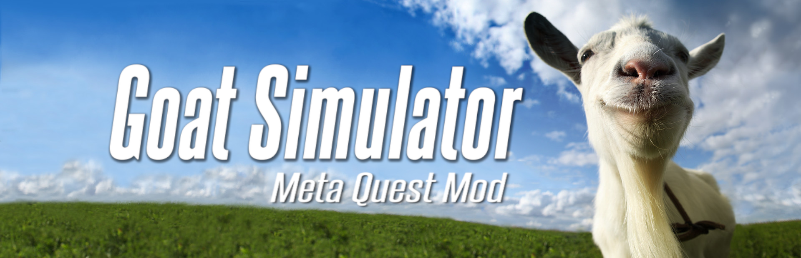
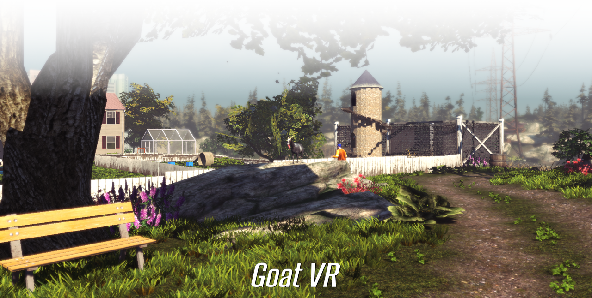

<p align="center">
  
</p>

<p align="center">
  <a href="#download"></a>
  <a href="#installation"></a>
  <a href="#features"></a>
  <a href="#controls"></a>
  <a href="#vr-settings"></a>
  <a href="#known-issues"></a>
  <a href="#disclaimer"></a>
</p>

<p align="center">
  <b>Play the original Goat Simulator in standalone VR. Based on the mobile phone version.</b>
</p>

</br>

> [!IMPORTANT]
> Only download and use this mod if you legally own Goat Simulator for Android/mobile.
>
> GoatVR is an unofficial fan-made modification and is not affiliated with or endorsed by Coffee Stain Studios or Meta.
>
> Software modification and distribution rules can differ between countries and regions. Make sure your use of GoatVR complies with the laws and licence terms that apply to you.

> [!NOTE]
> Don't forget you have access to a whole settings/mod menu! Press the quest menu button on your controller (when in the pause menu).

## About

**GoatVR** brings the original Goat Simulator to standalone Meta Quest VR.

The game runs directly on the headset no PCVR or streaming. A windows PC is needed for installing it, doenst need to be powerfull or fast.

GoatVR adds stereoscopic VR rendering, head tracking, Quest controller support and a dedicated VR settings/mod menu.

### Headset support

| Headset | Support |
|---|---|
| Meta Quest 3 | 🟢&nbsp;&nbsp; Supported |
| Meta Quest 3S | 🟢&nbsp;&nbsp; Supported |
| Meta Quest 2 | 🟡&nbsp;&nbsp; Should work (untested) |
| Quest Pro | 🟡&nbsp;&nbsp; Should work (untested) |

---

<a id="download"></a>

## Download

<p align="left">
  <a href="https://github.com/5chech/GoatsimVR/releases/latest"></a>
</p>

Download the latest version from the GitHub Releases page:

**[Go to Releases →](https://github.com/5chech/GoatsimVR/releases)**

---

<a id="installation"></a>

## Installation

> [!NOTE]
> You can also use any guide online to instal this. Just search how to instal an APK to a meta quest headset.

### 1. Enable Developer Mode

Your Quest must have **Developer Mode** enabled before APKs can be installed through ADB.

You will need to:

1. Create, use or convert to a Meta developer account.
2. Enable Developer Mode for your headset.
3. Connect the Quest to your PC using USB.
4. Accept the **USB debugging** prompt inside the headset.
5. Restart and wait a few minutes if the USB debugging prompt does not show.

### 2. Install ADB

> [!IMPORTANT]
> You must install Android Platform Tools on your PC to install with adb.

Connect your Quest and check that it is detected:

```cmd
adb devices
```

You should see your headset listed as a connected device.

### 3. Download GoatVR

Download the latest APK from:

**[Latest Release →](https://github.com/5chech/GoatsimVR/releases/latest)**

### 4. Install the APK

Open Command Prompt inside your Platform Tools folder and run:

```cmd
adb install -r GoatVR.apk
```

Replace `GoatVR.apk` with the actual filename of the downloaded APK.

Once installation finishes successfully, GoatVR will be installed on the headset.

### 5. Launch GoatVR

Launch GoatVR from your Quest.

From the Goat Simulator main menu, press **Play** as normal.

Don't forget you have access to a whole settings/mod menu! Press the quest menu button on your controller (when in the pause menu) to access.

---

<a id="features"></a>

## Features

| | |
| :--- | :--- |
| **Standalone Meta Quest VR** | No PCVR or game streaming needed. |
| **Stereoscopic 3D rendering** | Real 3D, not a 2D app that runs on a quest. |
| **Head tracking supported** | Look around to your goaty needs. |
| **Original Goat Simulator gameplay** | No gameplay is changed by default, just enjoy pure simulation of.. being a goat. |
| **Dedicated GoatVR settings/mod menu** | Change and access settings and mod things in game. |
| **Adjustable UI** | Change GUI size, positioning, layout and visibility. |
| **World settings** | Adjust gameplay settings like game speed, gravity, run speed, noclip and jump height. |
| **Built in update checker** | Automaticly checks this repo for updates. |
| **Runs directly on the Quest** | Once installed it runs standalone. |
| **Runs at 120 FPS** | The base game runs at 60 frames but this runs at 120 FPS! |

---

<a id="controls"></a>

## Controls

| Control | Action |
| :--- | :--- |
| **Left Stick** | Move |
| **Right Stick** | Look / Turn |
| **Either Trigger** | Headbutt |
| **Either Grip** | Lick |
| **A** | Jump |
| **B** | Ragdoll |
| **X** | Baaaaa |
| **Y** | POW |
| **Menu** | Pause / Settings |

The controller layout is designed for the Meta Quest Touch controllers.  
If you have suggestions on what to change them too for the quest 2 controllers let me know.

---

<a id="vr-settings"></a>

## VR Settings

GoatVR includes its own in-game VR settings/mod menu.

> [!NOTE]
> **While playing:**
>
> 1. Press the **Menu** button once to open the normal Goat Simulator settings/mod menu.
> 2. Press **Menu again** to open the GoatVR settings/mod menu.

---

<a id="known-issues"></a>

## Known Issues

GoatVR is still under development, so some issues remain.

### Passthrough / Resume

Entering Quest passthrough and then returning to GoatVR can currently breaks the game.

If the game becomes stuck after returning from passthrough, close GoatVR and launch it again.

### Quest 2

Quest 2 should work in theory but I don't have its hardware to test it.

If you test GoatVR on Quest 2, feedback is welcome.

---

## Bug Reports

If you find a reproducible problem, please open an issue:

<a href="https://github.com/5chech/GoatsimVR/issues"></a>

Useful information includes:

- GoatVR version
- Quest model
- What happened
- What you were doing when it happened
- Whether it happens every time
- Screenshots or video where useful

For crashes or technical issues, ADB/logcat output is especially helpful.

---

## Licence

Original GoatVR project material is licensed under the PolyForm Noncommercial License 1.0.0.

<a href="LICENSE"></a>
<br>
<a href="THIRD_PARTY_NOTICES.md"></a>

---

<a id="disclaimer"></a>

## Disclaimer

GoatVR is an unofficial, fan-made project.

Goat Simulator and all associated trademarks, names, game content, assets, code and intellectual property are the property of their respective rights holders.

GoatVR is not affiliated with, sponsored by, authorised by, endorsed by, or otherwise associated with Coffee Stain Studios, Coffee Stain Publishing, or Meta Platforms.

This project does not grant users any rights to Goat Simulator or its original content. Users are responsible for ensuring that they legally own or are otherwise authorised to use the game and that their use of GoatVR complies with any applicable licence terms, laws and regulations in their country or region.

GoatVR is provided as-is, without warranty. Use of the project is at the user's own risk.

<br><br>

<p align="center">
  
</p>
